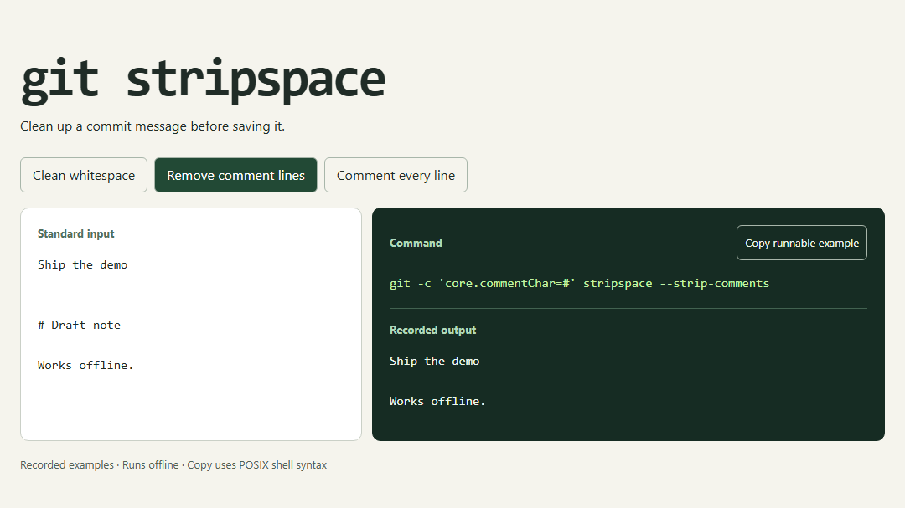

# TryCLI

Give someone three commands to try before they install your tool. TryCLI records each command against the same input and puts the results in one HTML file. Readers can switch examples, compare the output and copy a command with its input included.

[Try the Git demo](https://raw.githack.com/Potatohh/TryCLI/main/examples/git.html#example-2) · [Try the JSON demo](https://raw.githack.com/Potatohh/TryCLI/main/examples/json.html)



## Make your first demo

From a checkout of this repository, run the following with Node.js 22 or later and Git on your path.

    node build.mjs --record examples/git.json demo.html

Open `demo.html` in a browser. Click **Remove comment lines** to see what Git does to the sample commit message. **Copy runnable example** includes the input so you can repeat the command in a POSIX shell or Git Bash. An HTML file you have already downloaded works offline.

## Write a recipe

Save this as `recipe.json`. The command is an array so filenames and arguments can contain spaces.

```json
{
  "tool": "git stripspace",
  "description": "Clean up a commit message.",
  "input": "Ship the demo   \n\n\nToday.\n",
  "examples": [
    {
      "label": "Trim whitespace",
      "args": ["git", "stripspace"],
      "output": "Ship the demo\n\nToday.\n"
    }
  ]
}
```

With recorded output already in the recipe, run `node build.mjs recipe.json demo.html`. To capture fresh output from Git, add `--record`. Each command reads the shared input from stdin and runs in your current directory. Only record recipes you trust. A failed command stops the build. Use `--force` to replace a previous demo.

## Share it

Put the generated HTML on any static host and link to it from your README. Select an example and copy the address to open that example directly. You can also send the HTML file as an attachment. Visitors explore the examples you recorded. Running the copied command locally requires the tool shown in the demo.

## Test it

The generator uses Node's standard library. Browser tests are the only part that needs an npm dependency.

    node --test build.test.mjs
    npm ci
    npx playwright-core install chromium firefox webkit
    npm run test:browser

The example recipes and their generated pages live in [examples](examples). The JSON recipe uses Python 3.9 or later.

[MIT license](LICENSE)
